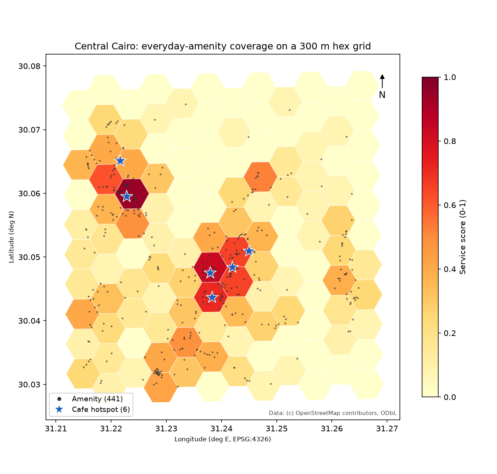

# Central Cairo: where are everyday amenities concentrated?

## Question

On a 300 m hexagonal grid over central Cairo (Downtown, Zamalek, Agouza and Mohandessin), which cells combine the most amenities with the most variety, and where do cafes cluster?

## Data

- File: `data/amenities_osm.geojson` (441 points, 82 KB, lon/lat EPSG:4326).
- Source: OpenStreetMap, queried through the Overpass API (`https://overpass-api.de/api/interpreter`) for `amenity` = school, university, hospital, clinic, cafe, restaurant, bank, supermarket, pharmacy inside the box lon 31.215 to 31.265, lat 30.030 to 30.075. Ways and relations are reduced to their centre point.
- License: ODbL 1.0, (c) OpenStreetMap contributors (<https://www.openstreetmap.org/copyright>).
- Date fetched: 2026-11-15 (OSM data timestamp 2026-11-15T09:42Z).
- The study area is that box; no administrative boundary is used. The data is a snapshot of volunteer mapping and is not a complete census of businesses.

## Method

All steps use this repository's `hexanalysis` package (`showcase/make_showcase.py`):

1. Amenities are read from `data/`, then projected to WGS 84 / UTM zone 36N (EPSG:32636, metres).
2. `create_hex_grid_gdf` builds flat-top hexagons of 300 m radius (about 0.234 km² each) over the box; 126 cells intersect it.
3. `aggregate_amenities` counts amenities and distinct amenity types per cell.
4. `compute_scores` gives each cell a 0-1 score: 65% normalised density (per km²), 35% normalised diversity.
5. `detect_hotspots` runs DBSCAN on cafe points (eps 150 m, at least 4 cafes).
6. Results are reprojected to EPSG:4326 for `map.geojson` (lon, lat order, RFC 7946).

## Results

- 441 amenities: 158 restaurants, 117 cafes, 58 banks, 43 hospitals, 25 schools, 23 pharmacies, 11 clinics, 6 universities (no supermarkets were returned by the query).
- The highest-scoring cell (score 0.94) is in Mohandessin/Agouza near 31.224 E, 30.060 N: 34 amenities of 5 types, 145 per km².
- The second (0.83) is in Downtown near 31.238 E, 30.048 N: 28 amenities of 5 types, 120 per km².
- The 10 best cells hold 43% of all amenities; 47 of the 126 cells have none (some of these are edge cells that extend beyond the data box).
- DBSCAN finds 6 cafe clusters; the largest has 21 cafes, near 31.223 E, 30.060 N.



- Web map: [index.html](index.html) (Leaflet, needs internet for tiles; serve the folder with `python -m http.server` so `map.geojson` can load)
- Notebook: [showcase.ipynb](showcase.ipynb)
- Result data: [map.geojson](map.geojson)

## Rebuild

```bash
pip install -e .[dev]
python showcase/make_showcase.py
```

This runs offline from `showcase/data/`. `tests/test_showcase.py` checks that `map.geojson` is up to date. To refresh the notebook outputs run `python -m jupyter nbconvert --to notebook --execute --inplace showcase/showcase.ipynb`.
